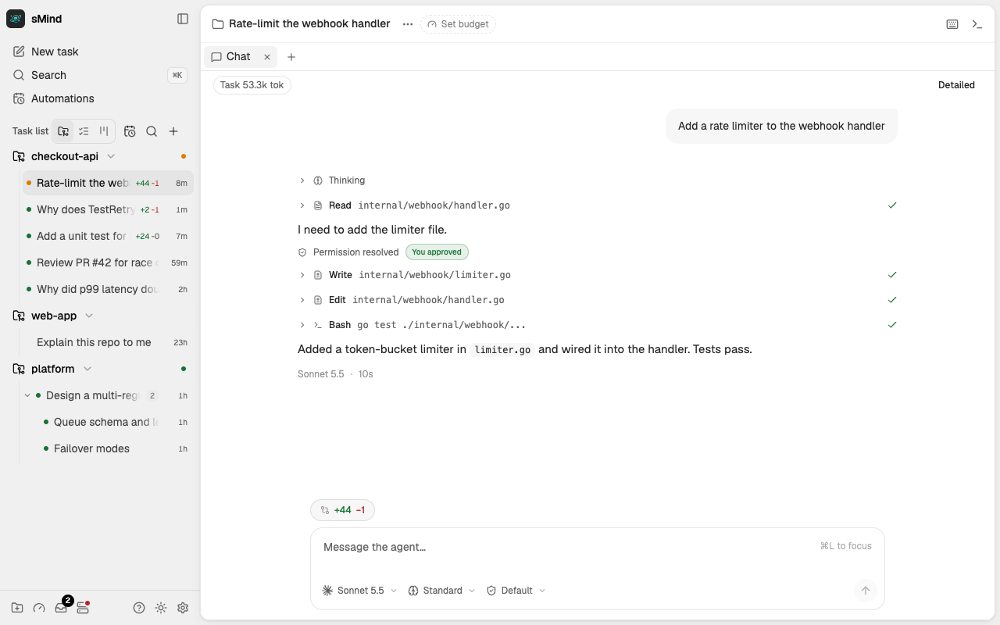

<p align="center">
  
</p>

<h1 align="center">sMind</h1>

<p align="center"><strong>Space for your agents, free for you.</strong></p>

<p align="center">
  A self-hosted platform that runs coding agents, each task in its own git
  worktree, on your own provider accounts.
</p>

<p align="center">
  <a href="https://github.com/spacingmind/smind/actions/workflows/ci.yml"></a>
  <a href="https://goreportcard.com/report/github.com/spacingmind/smind"></a>
  <a href="LICENSE"></a>
</p>

<p align="center">
  <a href="https://spacingmind.com">Website</a> |
  <a href="https://docs.spacingmind.com">Docs</a> |
  <a href="https://app.spacingmind.com/">Live demo</a> |
  <a href="#install">Install</a> |
  <a href="#what-you-can-do">Features</a>
</p>

<p align="center">
  
</p>

> **Status: early / pre-1.0.** The core daemon, CLI, and web UI are usable
> day to day, but expect rough edges and breaking changes before `v1`. See
> [docs/ROADMAP.md](docs/ROADMAP.md) for what's done and what's next.

## What sMind is

smind is a self-hosted platform for running coding agents. It is one Go binary
that serves both the API and a web interface, and it spreads agent traffic
across your own provider accounts instead of a single shared pool. Each task
runs in its own isolated git worktree, so several agents can work on one
repository without stepping on each other. You use it from the web app, the
desktop app, the command line or a phone.

## Install

| Platform | Command or download | More |
| --- | --- | --- |
| macOS, Linux | `curl -fsSL https://spacingmind.com/install.sh \| sh` | [Pin a version, install as a service](public-docs/getting-started.md) |
| Windows | `irm https://raw.githubusercontent.com/spacingmind/smind/master/scripts/install.ps1 \| iex` | Needs Git for Windows; [details](public-docs/getting-started.md) |
| Desktop app | [Releases](https://github.com/spacingmind/smind/releases): macOS `.dmg` per architecture, Windows `-setup.exe` or `.msi` | macOS build is not notarized yet; [details](public-docs/getting-started.md) |
| Docker | `ghcr.io/spacingmind/smind` (amd64, arm64) | [Run the daemon in Docker](public-docs/running-the-daemon.md) |
| Mobile | Not published yet; build it from source | [Mobile and relay pairing](public-docs/mobile-and-relay.md) |
| From source | `go install github.com/spacingmind/smind/cmd/smind@latest` | [Getting started](public-docs/getting-started.md) |

## Get started

1. [Install](public-docs/getting-started.md) smind.
2. Start the daemon and open <http://localhost:4648> in a browser:

   ```sh
   smind serve
   ```

3. Connect a provider under Settings → Providers: log in with the agent's own
   CLI, then check it with the Test button or `smind account test`. See
   [Providers](public-docs/providers.md).
4. Add a workspace (an existing git repository) and create a task. smind gives
   the task its own worktree; send your prompt in the task's chat. See
   [Workspaces and tasks](public-docs/workspaces-and-tasks.md).

## What you can do

- **Run agents in parallel**: every task works in its own worktree, with
  chats, attachments and a prompt queue.
  [Workspaces and tasks](public-docs/workspaces-and-tasks.md)
- **Stay in control**: [permission modes](public-docs/scripting-and-permissions.md),
  a standing [permission policy](public-docs/permission-policy.md), one
  [inbox](public-docs/inbox.md) for everything that needs you, and
  fresh-context [validator](public-docs/validator-and-review.md) and
  [Steward review](public-docs/steward-review.md) checks.
- **Work with git and pull requests**: publish branches, open pull requests,
  follow checks and review threads, stack sub-tasks.
  [Git and pull requests](public-docs/git-and-prs.md)
- **Spread load across accounts**: see plan usage windows per account, route
  around exhausted ones and fail over on rate limits.
  [Usage and limits](public-docs/usage-and-limits.md)
- **Orchestrate**: a Lead agent launches Peer agents as child tasks, with
  budgets and stall alerts. [Orchestration](public-docs/orchestration.md)
- **Automate**: start a task on a schedule or when a GitHub workflow fails
  ([automations](public-docs/automations.md)); drive smind from scripts,
  another agent over [MCP](public-docs/scripting-and-permissions.md), or the
  [CLI](public-docs/cli-reference.md).
- **Reach it from anywhere**: desktop app, a phone paired through an
  end-to-end-encrypted relay ([mobile](public-docs/mobile-and-relay.md)), and
  [connected hosts](public-docs/hosts.md).
- **Extend**: plugins add MCP servers, skills, agent profiles, prompt
  commands and themes. [Plugins](public-docs/plugins.md)

## Supported agents

| Agent | How smind runs it | Login |
| --- | --- | --- |
| Claude Code | the `claude` command | the CLI's own login |
| Codex | `codex app-server` | the CLI's own login |
| GLM | `npx -y glm-acp-agent` (needs Node.js) | managed by GLM's own CLI |
| Kimi | `kimi acp` | a logged-in Kimi Code CLI, or a Kimi API key |
| OpenCode, GitHub Copilot, Cline, Goose, Cursor | over ACP, each with its own command | each agent's own login |

Install each agent's own command first; smind does not install it for you
(GLM downloads through `npx`). Of the ACP agents, only OpenCode has been
checked (the real CLI against a local fake server); the others are not
verified against a real login. Built-in recipes also point Claude Code or Codex at a
compatible OpenAI-style endpoint, including local model servers: you paste a
key, and a few recipes need a URL or a model id. See
[Providers](public-docs/providers.md) and
[Provider recipes](public-docs/provider-recipes.md).

## Privacy and data

- State stays on your machine in the smind home (`~/.smind`, or `SMIND_HOME`):
  the database, `config.yaml` and the daemon log.
  [Configuration](public-docs/configuration.md),
  [Run the daemon](public-docs/running-the-daemon.md)
- Provider keys are stored write-only: after you set one, only a fingerprint
  is ever shown; the value never appears in `config.yaml`, logs or command
  lines. [Write-only secrets](public-docs/write-only-secrets.md)
- Old run history is trimmed to prompts, answers and summaries; for Claude
  Code and Codex runs, **Load full history** reads the complete turn back
  from the provider's own session file on the same machine, on request.
  [Troubleshooting](public-docs/troubleshooting.md)
- The phone relay is end-to-end encrypted: it forwards sealed bytes and cannot
  read your code, prompts or agent output.
  [Mobile and relay pairing](public-docs/mobile-and-relay.md)
- smind has no telemetry or analytics. Its network use is the providers and
  git hosts you connect, update checks against GitHub releases, a push service
  only when a phone has notifications on, and a relay only if you configure
  one.
- The desktop apps check for updates on their own and ask before downloading.
  [Run the daemon](public-docs/running-the-daemon.md)

## Documentation

User documentation lives in [public-docs/](public-docs/index.md):

- [Getting started](public-docs/getting-started.md)
- [Providers](public-docs/providers.md)
- [Workspaces and tasks](public-docs/workspaces-and-tasks.md)
- [Git and pull requests](public-docs/git-and-prs.md)
- [Mobile and relay pairing](public-docs/mobile-and-relay.md)
- [Orchestration](public-docs/orchestration.md)
- [Scripting and permissions](public-docs/scripting-and-permissions.md)
- [Run the daemon](public-docs/running-the-daemon.md) (service, remote access, Docker, updates)
- [CLI reference](public-docs/cli-reference.md)
- [Configuration](public-docs/configuration.md)
- [Troubleshooting](public-docs/troubleshooting.md)

Architecture, decision records and plans for contributors are in
[docs/](docs/).

## Contributing

See [CONTRIBUTING.md](CONTRIBUTING.md) for the branching model, Conventional
Commits convention, spec-driven development practice, and how to build and
test from source.

## License

[AGPL-3.0](LICENSE)
